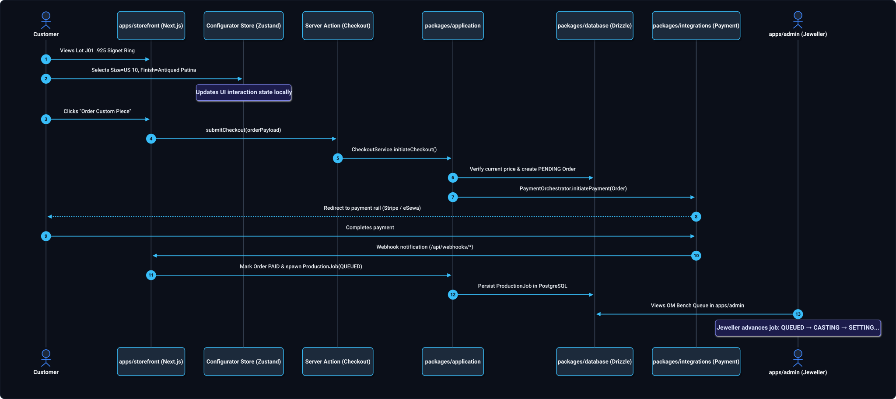
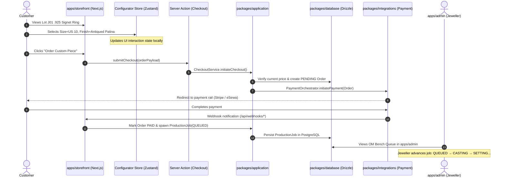

# PROJECT 925 — Kathmandu .925 Sterling Silver Artisan Jewellery Atelier

> **Crafted in the Kathmandu Workshop, Nepal. Worn Worldwide.**  
> An artisan direct-to-consumer jewellery atelier dedicated exclusively to handcrafted .925 sterling silver, built on Next.js 15, Supabase, Drizzle ORM, and Turborepo.

---

## 1. Brand & Commerce Overview

**Project 925** operates strictly out of the **Kathmandu Workshop** in Nepal, serving a global audience of collectors and patrons. The atelier specializes exclusively in handcrafted .925 sterling silver artisan jewellery:
- **Order-Made (OM) Pieces:** Bespoke signet rings, ancient Newar repoussé talisman pendants, sculptural cuffs, and cast chains forged and finished to individual customer specifications upon payment.
- **Ready-to-Ship (DROP) Releases:** Small-batch, numbered limited editions (e.g. 25 numbered talisman pendants, 15 heavy .925 silver cuffs) with immediate inventory reservations and 24–48 hour dispatch.
- **TOGETHER & Membership:** Access-controlled community releases, early purchase priority windows, and private co-commissioning salons.
- **Dynamic Category Architecture:** Real-time category creation, reordering, and visibility toggling managed directly by workshop staff via the Admin workbench.

The customer interface follows a **restrained, minimalist editorial aesthetic**: generous whitespace, subtle tactile borders, raw tactile tones (oxidized sulfur silver, high-mirror highlights, warm bone substrates), and macro-photography capturing authentic metalsmith chisel and crucible textures.

---

## 2. Core Architecture & Tech Stack

The platform is designed as a **Domain-Driven Design (DDD) Modular Monolith** housed in a high-performance monorepo:

| Layer | Technology | Key Responsibility |
| :--- | :--- | :--- |
| **Monorepo Engine** | **Turborepo + pnpm** | Cached task orchestration, strict package boundaries, fast builds. |
| **Customer Storefront** | **Next.js App Router (React 19)** | High-speed Server Components, SEO metadata, editorial shop UI (`apps/storefront`). |
| **Workshop Admin Portal**| **Next.js App Router (React 19)** | Real-time OM jewellery bench kanban, dynamic category management (`/categories`), order fulfillment (`apps/admin`). |
| **State Management** | **Zustand** | Ephemeral browser interaction only (cart drawer, active configurator selections). Server remains authoritative. |
| **Backend & APIs** | **Next.js Server Actions & Route Handlers** | Server Actions for application mutations; Route Handlers for external webhooks. Zero standalone microservices. |
| **Database & ORM** | **Supabase PostgreSQL + Drizzle ORM** | Type-safe SQL schemas, zero-cold-start queries, version-controlled migrations (`packages/database`). |
| **Contracts & Validation**| **Zod** | Shared schemas validating API payloads, forms, and external webhooks (`packages/contracts`). |
| **Payment Orchestrator** | **Multi-Rail Provider Gateway** | Provider abstraction routing international cards via **Stripe** and Nepal domestic rails via **eSewa / Khalti** (`packages/integrations`). |
| **UI Architecture** | **Application-Local Components** | Dedicated presentation components and tokens per app (`apps/storefront/components`, `apps/admin/components`). |
| **Observability** | **Structured Logger** | Request correlation IDs, order state transitions, and audit tracing (`packages/observability`). |

---

## 3. Monorepo Directory Layout

```text
jeanius/
├── apps/
│   ├── storefront/                 # Customer-facing Next.js App Router webstore (Port 3000)
│   │   ├── app/                    # Catalog, Product Detail (/shop/[slug]), Sizing Studio, Cart, Account
│   │   ├── components/             # Storefront UI primitives (PriceDisplay, StatusBadge, Header, CategoryBar)
│   │   ├── stores/                 # Zustand client stores (cart-store, configurator-store, ui-store)
│   │   └── package.json
│   └── admin/                      # Internal Kathmandu Workshop Next.js application (Port 3001)
│       ├── app/                    # OM Jewellery Bench Kanban (/workshop/jeweller), Categories (/categories), Orders
│       ├── components/             # Admin UI primitives (AdminNav, StatusBadge, PriceDisplay)
│       └── package.json
│
├── packages/
│   ├── domain/                     # Pure TypeScript DDD entities & value objects (Zero external dependencies)
│   │   └── src/catalog/            # Product, Category, Variant, Cart, Order, ProductionJob, Money
│   ├── application/                # Use cases, application services, and repository port interfaces
│   │   └── src/                    # CatalogService, CategoryService, CartService, CheckoutService
│   ├── database/                   # Supabase PostgreSQL + Drizzle ORM schemas, migrations, repositories
│   │   ├── src/schema/             # products, categories, variants, orders, production_jobs
│   │   └── src/repositories/       # Drizzle implementations of application repository ports
│   ├── contracts/                  # Zod validation schemas and shared DTO types
│   ├── integrations/               # External adapters: PaymentOrchestrator (Stripe & eSewa/Khalti)
│   ├── config/                     # Typed server and client environment validation
│   ├── observability/              # Structured JSON logging and correlation context
│   └── testing/                    # Test fixtures and domain entity mock factories
│
├── infrastructure/
│   └── supabase/                   # Local Supabase Docker config.toml, seed data, and RLS policies
│
├── docs/
│   ├── architecture/               # Architecture diagrams and system overview
│   ├── adr/                        # Architecture Decision Records (ADR-001 to ADR-007)
│   ├── assets/diagrams/            # Compiled SVG diagrams with dark atelier theme
│   └── product/                    # Complete product specifications and domain glossary
│
├── scripts/
│   ├── verify-monorepo.sh          # One-step workspace compilation & verification script
│   └── generate-diagrams.ts        # Central Mermaid SVG compilation tool
├── turbo.json                      # Turborepo task pipeline configuration
├── pnpm-workspace.yaml             # Monorepo workspace package declarations
└── tsconfig.base.json              # Shared strict TypeScript compiler settings
```

---

## 4. System Architecture & Data Flow

All interactions follow strict unidirectional flow and inversion of control:



<details>
<summary>View Diagram Source (Mermaid)</summary>



</details>

### Architectural Guardrails
1. **Domain Purity:** `@jeanius/domain` never imports React, Next.js, or database libraries.
2. **Repository Abstraction:** Application logic talks only to repository interfaces (`IProductRepository`, `ICategoryRepository`, `IOrderRepository`). Direct SQL/Drizzle calls live exclusively inside `@jeanius/database`.
3. **Server Authority:** Zustand manages client UI state only (e.g. drawer open/close, active button toggles). Prices, inventory checks, discount calculations, and order creation are **always authoritative on the server**.

---

## 5. OM Jewellery Manufacturing Pipeline

Project 925 operates an 8-stage manufacturing workflow for made-to-order silver jewellery in the Kathmandu Workshop:

```text
[1. QUEUED] ──► [2. CASTING] ──► [3. SETTING] ──► [4. PATINA]
                                                        │
[8. SHIPPED] ◄── [7. READY] ◄── [6. QC INSPECTION] ◄── [5. POLISHING]
```

* **1. QUEUED:** Bench job created upon payment; precious silver stock allocated and Bench Ticket printed.
* **2. CASTING [Point of No Return]:** Lost-wax investment mold burnout and centrifugal silver pour. Cancellation locked.
* **3. SETTING:** Sprue removal, mandrel trueing to exact US size, bezel stone setting, inside-band engraving.
* **4. PATINA:** Controlled chemical liver of sulfur oxidation for shadow depth in carved recesses.
* **5. POLISHING:** Multi-stage abrasive rouge buffing (High Mirror, Brushed Matte, or Antiqued).
* **6. QC INSPECTION:** Vernier caliper measurement (inner diameter tolerance ±0.1mm) and .925 hallmark stamp check.
* **7. READY:** Ultrasonic bath cleaning, wrapped in tarnish-preventing paper, placed in wooden presentation box with polishing cloth.
* **8. SHIPPED:** Tracking number registered and handed to carrier (HS Code 7113.11).

---

## 6. Developer Quickstart

### Prerequisites
* **Node.js:** `v22.x` or higher
* **pnpm:** `v11.x` (`corepack enable pnpm` or `npm install -g pnpm`)
* **Docker:** (Optional, for running local Supabase database via Supabase CLI)

### Installation & Setup

1. **Clone the repository:**
   ```bash
   git clone https://github.com/your-org/jeanius.git
   cd jeanius
   ```

2. **Install monorepo dependencies:**
   ```bash
   pnpm install
   ```

3. **Approve required native build scripts:**
   ```bash
   pnpm approve-builds --all
   ```

### Running Applications Locally

Start all workspace applications concurrently with Turborepo:
```bash
pnpm turbo run dev
```

* **Customer Storefront:** [http://localhost:3000](http://localhost:3000)
* **Workshop Admin Portal:** [http://localhost:3001](http://localhost:3001)

### Code Quality & Testing

```bash
# Typecheck all workspace packages and applications
pnpm turbo run typecheck

# Build all packages and applications for production
pnpm turbo run build

# Run unit and integration test suites
pnpm turbo run test

# Run the complete automated monorepo verification script
./scripts/verify-monorepo.sh
```

---

## 7. Architecture Decision Records (ADRs)

Key architectural decisions are formally documented in [docs/adr/](file:///home/sarakb/projects/Jeanius/docs/adr):

* [ADR-001: Modular Monolith Architecture](file:///home/sarakb/projects/Jeanius/docs/adr/ADR-001-modular-monolith.md) — Rejecting premature microservices in favor of strict workspace packages.
* [ADR-002: Supabase PostgreSQL + Drizzle ORM](file:///home/sarakb/projects/Jeanius/docs/adr/ADR-002-drizzle-and-supabase.md) — Choosing lightweight, high-performance Drizzle over Prisma for serverless edge stability.
* [ADR-003: Zustand for Client-Side State Management](file:///home/sarakb/projects/Jeanius/docs/adr/ADR-003-zustand-client-state.md) — Enforcing strict separation between ephemeral UI state and server authority.
* [ADR-004: Next.js Server Boundary & API Strategy](file:///home/sarakb/projects/Jeanius/docs/adr/ADR-004-nextjs-server-boundary.md) — Utilizing Server Actions and Route Handlers instead of an independent API microservice.
* [ADR-005: Decoupled Payment Orchestrator Architecture](file:///home/sarakb/projects/Jeanius/docs/adr/ADR-005-payment-orchestrator.md) — Provider-independent multi-rail architecture supporting Nepal domestic and global payments.
* [ADR-006: Two-Phase Inventory Hold](file:///home/sarakb/projects/Jeanius/docs/adr/ADR-006-two-phase-inventory-reservation.md) — Claim + 10-minute TTL atomic reservation preventing overselling on limited drops.
* [ADR-007: Transactional Outbox Pattern](file:///home/sarakb/projects/Jeanius/docs/adr/ADR-007-transactional-outbox-pattern.md) — Atomically staging domain events in PostgreSQL to guarantee reliable asynchronous delivery.

---

## 8. License & Craftsmanship

Proprietary and confidential. Developed for **Project 925 Artisan Jewellery Atelier (Kathmandu Workshop)**.  
All rights reserved © 2026.
