# PROJECT 925 — PRODUCT CONTRACT & SPECIFICATION

**Document Version:** 2.0.0  
**Status:** Frozen Implementation Contract  
**Scope:** Foundational Architecture Contracts (JN-001 to JN-015) — Kathmandu .925 Sterling Silver Artisan Jewellery

---

## 1. Product Scope Matrix (JN-001)

The scope for Project 925 is strictly focused on high-craft execution across the Kathmandu-based .925 sterling silver artisan jewellery vertical:

| Feature Area | MVP (Launch Target) | Phase 2 (Fast Follow) | Explicitly Excluded |
| :--- | :--- | :--- | :--- |
| **Catalog & Models** | • Order-Made (OM) .925 Sterling Silver Rings, Pendants, Sculptural Cuffs, Cast Chains<br/>• Small-batch Ready-to-Ship (DROP) talisman pendants, solid .925 cuffs<br/>• Dynamic Category Management (Admin CRUD + Storefront category bar)<br/>• Dynamic OM lead-time badge | • Gated community drops (TOGETHER)<br/>• Pre-orders for upcoming metal castings & rare repoussé motifs | • Multi-vendor marketplace<br/>• Digital goods / NFTs<br/>• Apparel / Denim |
| **Product Configurator** | • Jewellery: Ring Size (US 3–16 in quarter increments), Wide Shank Compensator (+0.5 size), Cuff Wrist Circumference & Gap, Chain Drape Length (18"–28"), Metal Alloy (.925 Sterling Silver, optional solid brass accents), Surface Patina (High Mirror, Antiqued Sulfur, Brushed Matte), Custom Inside-Band Engraving | • Custom lost-wax signet wax crests<br/>• Bespoke repoussé talisman relief commissions | • 3D real-time mesh rendering (distracting to minimalist aesthetic) |
| **Checkout & Payments** | • Single-page international address validation<br/>• Multi-rail payment (Stripe USD card rails + Nepal domestic eSewa/Khalti NPR rails)<br/>• Dynamic shipping calculation | • Split payments<br/>• Multi-currency crypto rails | • Unauthenticated / guest checkout without email confirmation |
| **Workshop & Operations** | • 8-Stage OM Jewellery Production Kanban in `apps/admin`<br/>• Bench-Ticket tracking (Metalsmith bench)<br/>• Kathmandu Workshop only<br/>• Delay recording & notes | • Automated barcode/QR label scanning<br/>• Raw silver scrap recycling & crucible melt batching | • Heavy third-party ERP integration (SAP, Oracle) |
| **Fulfillment & Logistics** | • Manual tracking number assignment<br/>• Courier status synchronization (DHL / Aramex / EMS)<br/>• Precious metals export declaration (HS Code 7113.11) | • Automated shipping rate API integration (EasyPost/Shippo)<br/>• Local pickup locker network | • Dropshipping from unverified third-party suppliers |
| **Customer Experience** | • Order tracking & OM timeline visualization<br/>• Editorial guide (Sizing for Rings, Mandrels, Cuffs, Chains, Silver Care & Patina)<br/>• Direct Instagram DM / Email support | • Verified purchase reviews with photo upload<br/>• Community silver oxidation & patina aging gallery | • AI chatbot customer support |

---

## 2. Formalized Commerce Models (JN-002)

### A. Order-Made (OM) — Made to Order
* **Core Principle:** Precious metal jewellery pieces custom cast, sized, engraved, and hand-finished only after customer payment.
* **Material & Atelier Fabrication:**
  * Zero finished goods inventory required. Orders lock reservations on fine silver casting grain and certified .925 sterling alloy batches.
  * Rings, chains, and hardware are individually cast via lost-wax investment flask burnout, sized on precision steel mandrels, hand-finished, oxidized, and stamped with official atelier hallmarks (.925 Silver, Project 925 emblem).
* **Production Policy:** Governed dynamically by `ProductionPolicy` (default: 7–14 business days, automatically extending for official Nepal workshop holidays).
* **Cancellation & Refund Contract:**
  * **Pre-Crafting:** The customer may cancel within 24 hours of payment if the job has not entered the `CASTING` stage (100% refund).
  * **Post-Crafting (Point of No Return):** Once the metalsmith melts and pours the silver into the investment mold (`CASTING`), cancellation or return is **strictly prohibited**, except in cases of proven manufacturing defect (deviation > ±0.1mm from approved bench ticket).

### B. DROP — Ready-to-Ship
* **Core Principle:** Pre-manufactured physical inventory produced in limited numbered batches (e.g. 25 hand-forged talisman pendants, 15 numbered .925 heavy cuffs).
* **Inventory Behavior:** Variant inventory count decrements immediately upon checkout confirmation. Once inventory hits 0, variant transitions to `SOLD_OUT`.
* **Fulfillment Window:** Dispatches from the Kathmandu workshop warehouse within 24–48 hours.
* **Return & Refund Contract:** Customers have a 5-day inspection window from the carrier delivery timestamp. Returned goods must be unworn, undamaged, with original tags, hallmarks, and packaging intact.

### C. Custom Atelier Inquiries (Bespoke)
* **Core Principle:** Personalized, non-standard jewellery commissions (custom family crest signets, deep repoussé talisman motifs, bespoke heirloom silver).
* **Workflow:** Non-payable inquiry submitted via storefront form → Admin reviews and issues formal quote (Price + Lead Time) → Customer accepts and pays → Converts into standard OM order.

### D. TOGETHER — Member-Only Releases
* **Core Principle:** Protected, small-batch artisan jewellery releases accessible only to authenticated members or designated access pass holders.
* **Security Guardrail:** Server Components enforce authorization before serving product metadata or images, preventing media scraping.

---

## 3. Actor Model & Permissions (JN-003)

| Actor Role | Authentication | Permitted Capabilities | Prohibited Operations |
| :--- | :--- | :--- | :--- |
| **GUEST** | None (Anonymous session) | Browse public catalog, configure jewellery options, calculate shipping rates, add items to cart, checkout with email. | Cannot access TOGETHER drops, view private order history, or access administrative tools. |
| **CUSTOMER** | Authenticated (Email/Password) | Place orders, view personal order history, inspect live OM bench status, save shipping addresses and jewellery sizing vault. | Cannot view workshop boards, manipulate prices, or access internal production notes. |
| **MEMBER** | Authenticated + Member Flag | All Customer capabilities + access to restricted `TOGETHER` drops and early-access windows. | Cannot access administrative features. |
| **JEWELLER** | Authenticated + Jeweller Role | Access `apps/admin` OM queue, inspect bench tickets, advance jewellery production stages, record delay notes. | Cannot alter product prices, view customer credit card details, or issue financial refunds. |
| **FULFILLMENT** | Authenticated + Fulfillment Role | Access ready orders in `apps/admin`, package orders in presentation boxes, generate waybills, record carrier tracking numbers. | Cannot modify product configurations or advance bench stages. |
| **SUPPORT** | Authenticated + Support Role | Search orders, view customer history, update shipping addresses prior to dispatch, resolve tickets. | Cannot modify database schemas or execute raw database updates. |
| **ADMIN** | Authenticated + Admin Role | Full operational control: manage catalog, configure dynamic categories, adjust `ProductionPolicy`, adjust stock, issue refunds. | None. |

---

## 4. Order Lifecycle State Machine (JN-004)

Every commercial transaction follows an immutable state machine supporting multi-package split fulfillment:


<details>
<summary>View Diagram Source (Mermaid)</summary>

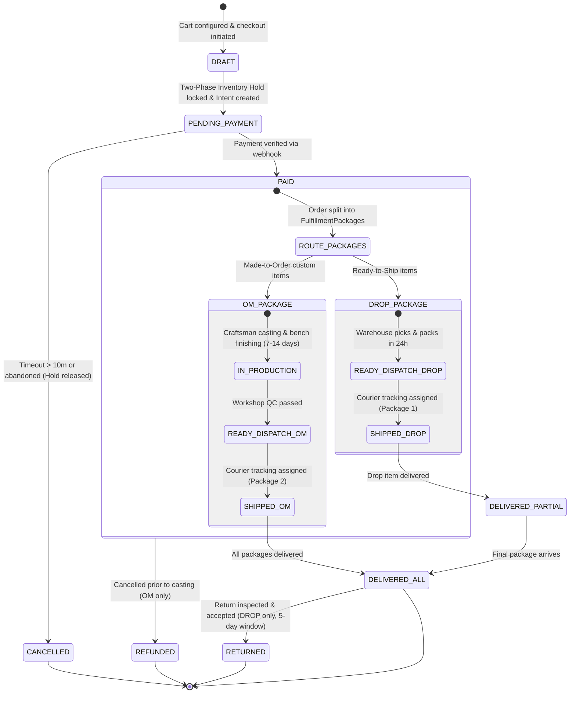

</details>

### State Definitions & Rules
1. **DRAFT:** Ephemeral cart state.
2. **PENDING_PAYMENT:** Order created with frozen line items and locked price snapshot. A 10-minute Two-Phase Inventory Hold is actively reserved for DROP items.
3. **PAID:** Payment confirmed by verified webhook. If OM lines are present, a `ProductionJob` is created for each custom line item.
4. **MULTI-PACKAGE SPLIT FULFILLMENT:**
   - Orders containing both ready-to-ship DROP items and custom Order-Made jewellery split into independent `FulfillmentPackage`s.
   - **Package 1 (DROP):** Dispatches from Kathmandu warehouse within 24–48 hours via DHL Express.
   - **Package 2 (OM):** Dispatches upon completing all 8 workshop bench stages (7–14 days).
5. **SHIPPED:** Courier tracking numbers assigned to respective packages.
6. **DELIVERED_ALL:** All packages delivered to customer.

---

## 5. OM Manufacturing Lifecycle (JN-005)

The craftsmanship pipeline is the heart of Project 925. Every piece of custom sterling silver jewellery progresses through eight mandatory stages in the Kathmandu Workshop:


<details>
<summary>View Diagram Source (Mermaid)</summary>

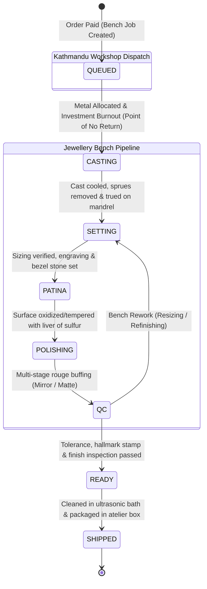

</details>

### Workshop Stage Details (Jewellery Bench Pipeline)
1. **STAGE 1 — QUEUED:** Order received. Metalsmith allocates certified .925 sterling silver casting grain and prints bench ticket.
2. **STAGE 2 — CASTING:** **[POINT OF NO RETURN]** Lost-wax investment flask burnout and centrifugal/vacuum silver pour. Cancellation is permanently locked.
3. **STAGE 3 — SETTING:** Sprues removed, band trued on precision steel mandrel to exact US size, bezel stones set, and inside-band engraving inscribed.
4. **STAGE 4 — PATINA:** Controlled liver of sulfur oxidation or heat tempering applied for deep shadows and antique character.
5. **STAGE 5 — POLISHING:** Multi-stage rouge buffing across abrasive compounds (High Mirror, Brushed Matte, or Antiqued contrast).
6. **STAGE 6 — QC INSPECTION:** Vernier caliper measurement (inner diameter tolerance ±0.1mm), hallmark stamp inspection (.925), and structural check.
7. **STAGE 7 — READY:** Ultrasonic bath cleaning, wrapped in tarnish-preventing paper, placed in solid wooden atelier presentation box with polishing cloth.
8. **STAGE 8 — SHIPPED:** Courier tracking number registered and dispatched from Kathmandu.

---

## 6. DROP Lifecycle & Return Policy (JN-006)

Unlike Order-Made pieces, DROP products represent limited physical batches manufactured and stored in the Kathmandu workshop warehouse before release.


<details>
<summary>View Diagram Source (Mermaid)</summary>

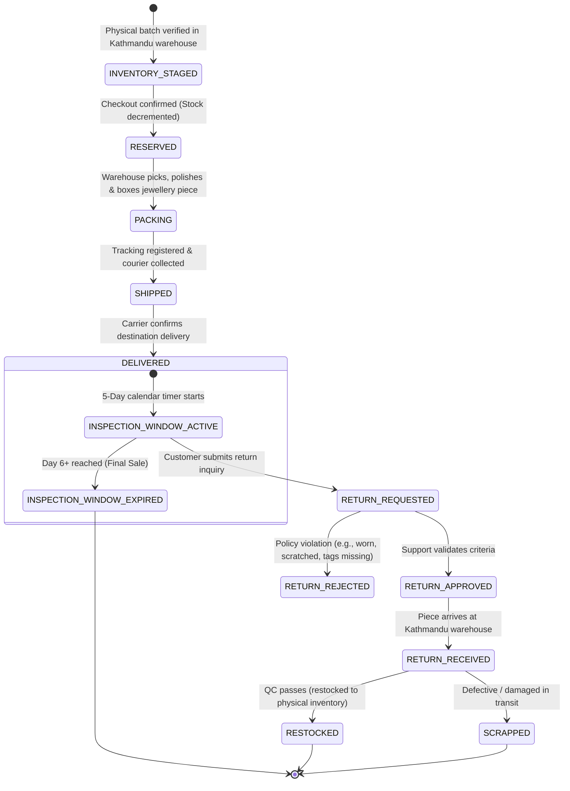

</details>

### DROP Return Policy Rules
1. **5-Day Inspection Window:** The customer has exactly 5 calendar days from the carrier-verified delivery timestamp to file a return request. On day 6, the sale becomes final and non-refundable.
2. **Condition Requirements:** The jewellery piece must be completely unworn, scratch-free, and retain original hallmark tags, velvet pouch, and atelier presentation packaging.
3. **Restocking Workflow:** Approved returns must be physically inspected by warehouse QC before entering `RESTOCKED` status or issuing financial refund credits.

---

## 7. Product Lifecycle & Dynamic Category Matrix (JN-007)

Every editorial style in the Project 925 catalog progresses through an explicit lifecycle governing catalog visibility, search engine indexing, and purchasing availability:


<details>
<summary>View Diagram Source (Mermaid)</summary>

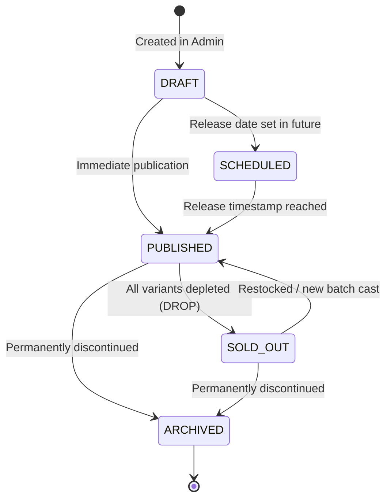

</details>

### Catalog Visibility Matrix

| Status | Storefront Catalog | Direct URL Access | Search Engine Indexing (Robots) | Purchasing Actions (Buy Now / Add to Cart) |
| :--- | :--- | :--- | :--- | :--- |
| **DRAFT** | Hidden | 404 (Admin Preview Only) | `noindex, nofollow` | Blocked |
| **SCHEDULED**| Visible as "Coming Soon" | Allowed (Countdown Active) | `index, follow` | Blocked until `publishAt <= now()` |
| **PUBLISHED**| Visible | Allowed | `index, follow` | Enabled |
| **SOLD_OUT** | Visible with "Sold Out" badge | Allowed | `index, follow` | Blocked (Restock Notification Available) |
| **ARCHIVED** | Hidden from index | Allowed for order history only | `noindex, nofollow` | Blocked permanently |

### Dynamic Categories Architecture
- **Admin Management:** Authorized staff manage categories in `apps/admin/app/categories/` (`name`, `slug`, `description`, `sortOrder`, `isActive`).
- **Storefront Navigation:** Storefront category bar (`apps/storefront/components/category-bar.tsx`) dynamically renders active categories from the database, filtering catalog products via URL search parameters (`/shop?category=rings`).

---

## 8. Variant Matrix & Inventory Lifecycle (JN-008)

A **Variant** represents a concrete, purchasable combination of options (e.g. Lot J01 Signet Ring, Size=US 10, Finish=Antiqued Patina, Metal=.925 Sterling Silver).


<details>
<summary>View Diagram Source (Mermaid)</summary>

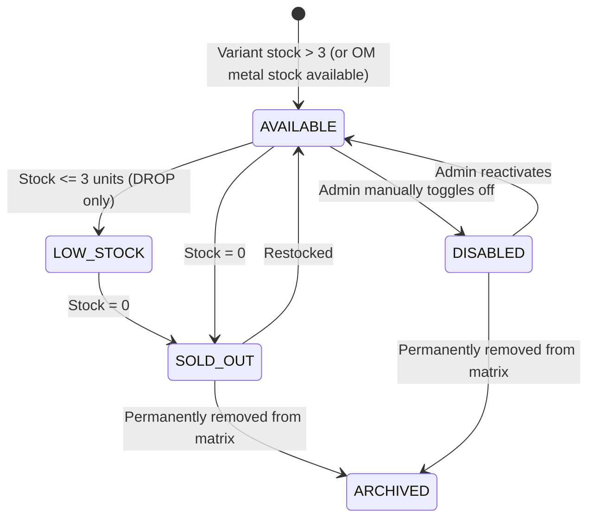

</details>

### Matrix Resolution & Invariants
1. **Independent Option Availability:** Individual option values (e.g., Size US 10 in Antiqued Finish) can transition to `SOLD_OUT` independently. The configurator dynamically disables unavailable combinations without marking the entire product sold out.
2. **Product-Level Sold Out Invariant:** A Product transitions to `SOLD_OUT` if and only if **all** of its purchasable variants are in `SOLD_OUT` or `DISABLED` states.
3. **Inventory Race Protection (Two-Phase Hold):** DROP variant inventory is protected by a two-phase atomic reservation (Claim + 10-minute TTL) to prevent overselling on limited jewellery drops.

---

## 8.B Two-Phase Inventory Hold (Claim + TTL) Architecture

During high-concurrency limited drop launches (e.g. 25 hand-forged solid .925 silver cuffs), the platform enforces an atomic reservation workflow before payment:

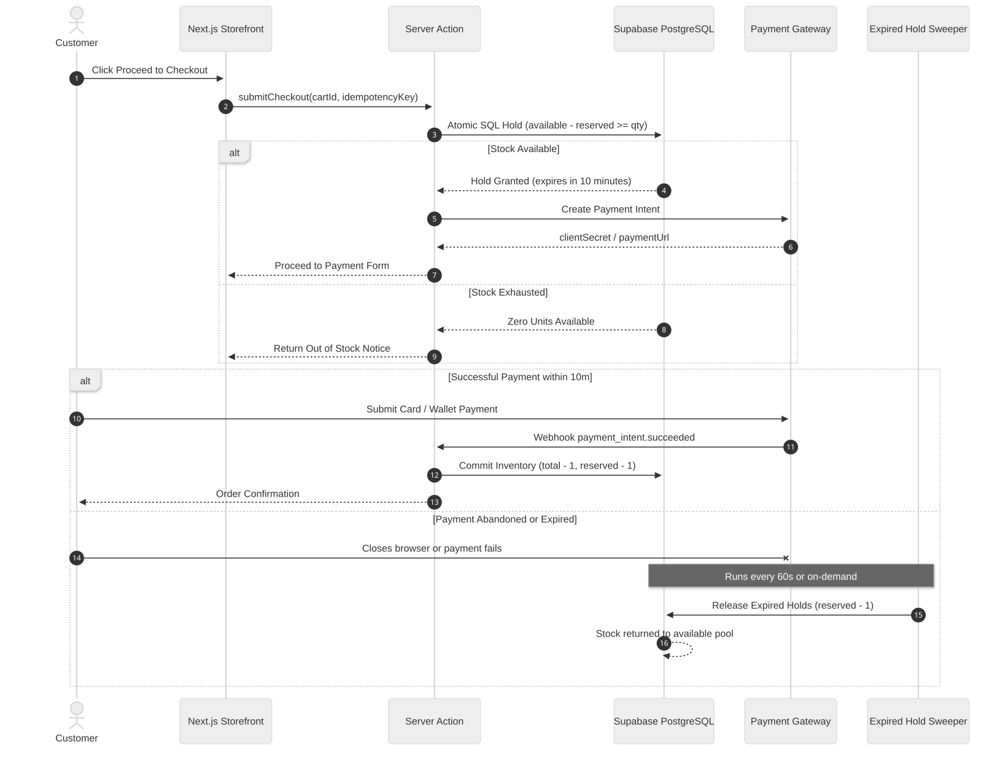

<details>
<summary>View Diagram Source (Mermaid)</summary>

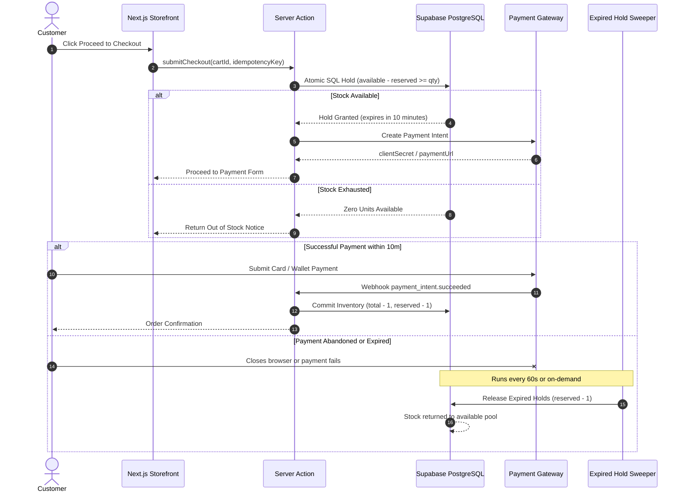

</details>

---

## 9. Payment Lifecycle & Provider Reconciliation (JN-009)

The payment domain operates entirely on internal `PaymentIntent` records decoupled from external gateway implementations:


<details>
<summary>View Diagram Source (Mermaid)</summary>

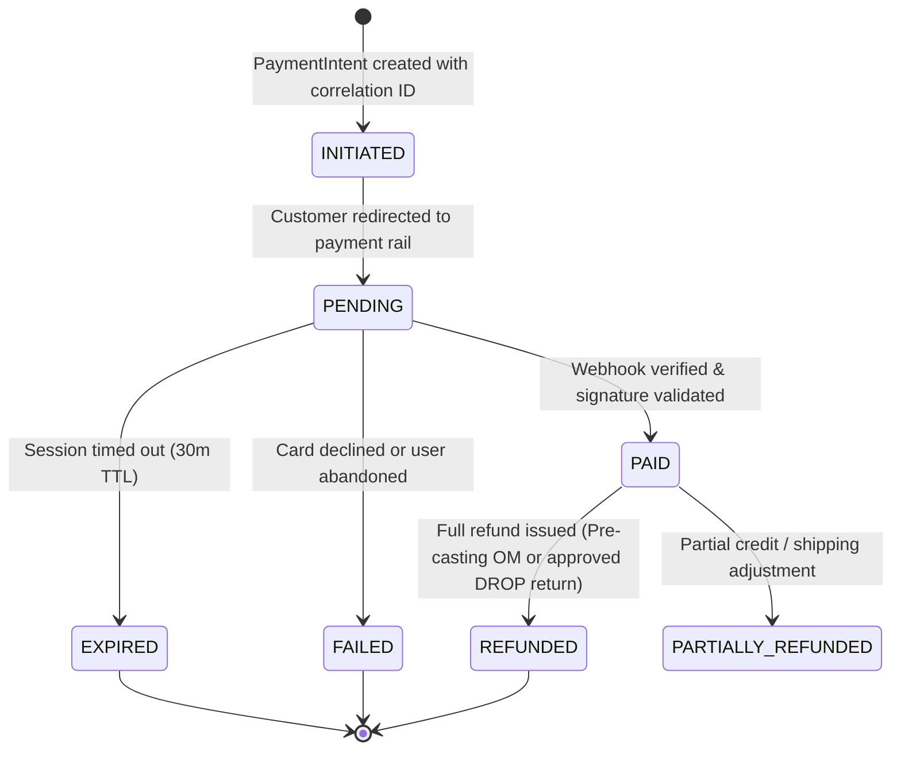

</details>

### Reconciliation & Multi-Rail Rules
1. **Multi-Rail Routing:**
   * **International Rail (USD):** Dispatched to Stripe Checkout (Cards, Apple Pay).
   * **Nepal Domestic Rail (NPR):** Dispatched to domestic digital wallets (eSewa, Khalti, Fonepay).
2. **Display vs. Settlement Separation:** Storefront displays customer currency (USD / EUR / NPR); merchant settlement occurs in the rail's native currency.
3. **Webhook Idempotency:** Webhook handlers record the gateway's event ID in an audit log. Duplicate webhook callbacks return `200 OK` immediately without re-triggering order state transitions.

---

## 10. OM Production Operations & Bench Ticket Specs (JN-010)

Entering the `CASTING` stage generates an immutable, printable **Bench Ticket** work order for the workshop metalsmith:

### Bench Ticket Specification
* **Job Identification:** `jobId`, `orderNumber`, `orderLineId`, `artisanAssigned`.
* **Sizing & Mandrel Specifications:** Ring Size (US 3–16 in quarter increments), Wide Shank Compensation (+0.5 size applied), Mandrel Inner Diameter (mm), Wrist Circumference & Gap (inches/mm), Chain Drape Length (inches).
* **Precious Metal Specifications:** Metal alloy (.925 Sterling Silver, solid brass accents), required casting grain mass (grams).
* **Surface & Finish Specifications:** Surface Patina (High Mirror, Antiqued Sulfur, Brushed Matte), inside-band custom engraving inscription.
* **Timestamps & SLA:** `orderPaidAt`, `targetCompletionDate` (calculated dynamically from `ProductionPolicy`).

### Delay Escalation & Rework Protocols
1. **Delay Management:** If a job encounters a bottleneck (e.g., custom casting mold rework), the jeweller records a formal `delayReason` and estimated revised completion date, automatically notifying support.
2. **QC Rework Protocol:** If a piece fails the Stage 6 QC inspection (diameter tolerance exceeded > ±0.1mm or hallmark defect), it is transitioned back to `SETTING` with a tagged defect note rather than discarded.

---

## 11. Shipment Lifecycle & Logistics Operations (JN-011)

All physical shipments dispatch strictly from the Project 925 workshop fulfillment hub in Kathmandu, Nepal, utilizing DHL Express, Aramex, or registered Nepal Post:


<details>
<summary>View Diagram Source (Mermaid)</summary>

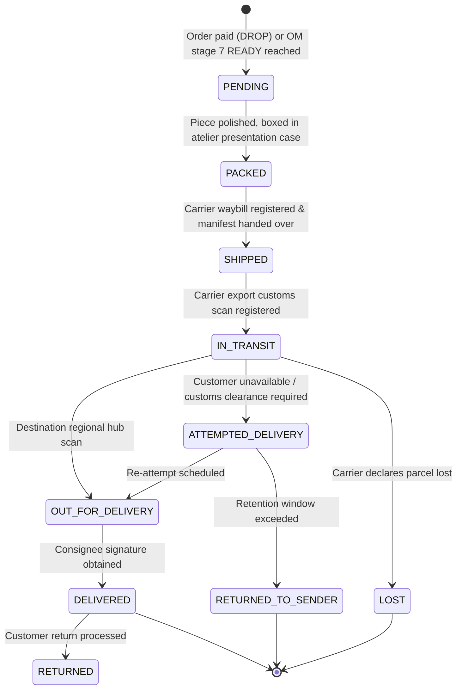

</details>

### Logistics Rules & Operational Invariants
1. **Immutable Waybill Binding:** Once a shipment transitions to `SHIPPED`, its `carrier` and `trackingNumber` are immutable. Any reshipment creates a new `Shipment` record linked to the original Order.
2. **Inspection Window Activation:** The carrier webhook registering the `DELIVERED` status updates `deliveredAt`, immediately starting the immutable 5-day DROP `InspectionWindow`.
3. **Customs & Commercial Invoice:** Every international parcel originating from Kathmandu includes an automated commercial invoice declaring harmonized tariff code `7113.11` (articles of jewellery of silver, whether or not plated or clad with other precious metal).
4. **Split Shipments:** Orders containing both ready-to-ship DROP items and OM items are defaulted to single-dispatch upon OM completion, unless split-shipping is explicitly requested and funded at checkout.

---

## 12. Return & Refund Policy Lifecycle (JN-012)

Customer return requests follow a strict state machine governed by the commerce model and physical inspection criteria:


<details>
<summary>View Diagram Source (Mermaid)</summary>

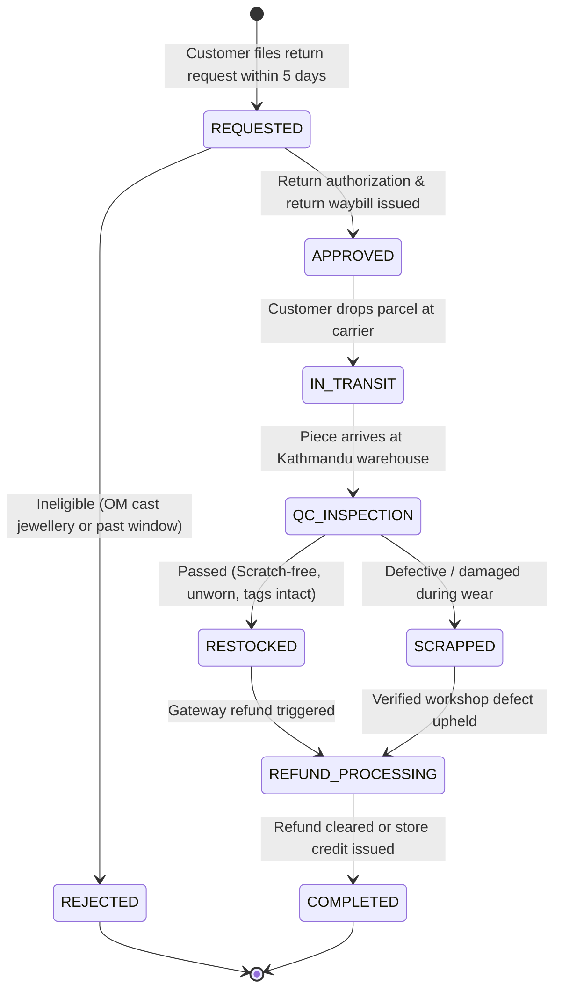

</details>

### Return Policy Invariants
1. **OM Non-Returnable Invariant:** Made-to-order (`OM`) jewellery pieces are strictly **final sale** once casting has commenced. The only exception is a verified manufacturing defect where measured inner ring diameter deviates beyond ±0.1mm from the approved Bench Ticket.
2. **DROP 5-Day Eligibility:** DROP items can only be returned if requested within 5 calendar days of the carrier's verified delivery timestamp (`deliveredAt`).
3. **Condition Criteria:** Pieces must be unworn, scratch-free, and returned in original condition with all hallmarks, velvet pouches, and presentation boxes intact.
4. **Refund Processing:** Approved returns result in a direct refund reversal via the original payment rail or store credit, triggered only after physical warehouse QC approval.

---

## 13. Membership & Access Control Model (JN-013)

Access to collections, editorial content, and workshop operations is governed by an explicit four-tier access hierarchy:

| Access Level | Permitted Actors | Catalog Visibility | Purchasing Privileges | Administrative Rights |
| :--- | :--- | :--- | :--- | :--- |
| **PUBLIC** | `GUEST` (Unauthenticated) | Standard OM & DROP jewellery, lookbooks, sizing guide | Full checkout on public items | None |
| **AUTHENTICATED**| `CUSTOMER` | Public catalog + personal order history, saved addresses, sizing vault | Full checkout, review submission | None |
| **MEMBER** | `MEMBER` | Public catalog + restricted `Together` drops, early access previews | Member pricing, exclusive artisan casting allocations | Community features |
| **INTERNAL_STAFF** | `JEWELLER`, `FULFILLMENT`, `SUPPORT`, `ADMIN` | Full catalog, draft previews, internal costs | Staff purchases | Operations board, Bench Tickets, Order management |

### Security & Anti-Leakage Invariants
1. **Zero Metadata Leakage:** Products with `accessLevel: 'MEMBER'` do not expose pricing, high-resolution media, or variant IDs in public React Server Component (RSC) HTML payloads, public REST feeds, or XML sitemaps.
2. **Server-Side Enforcement:** Attempting to view or purchase a member-restricted product without a verified session containing `role: 'MEMBER'` throws a 404 or redirects to authentication. Client-side hiding alone is unacceptable.

---

## 14. Customer Support & Custom-Order Boundaries (JN-014)

Project 925 strictly delineates communication channels between conversational pre-sales and authoritative transactional support:


<details>
<summary>View Diagram Source (ASCII Architecture)</summary>

```text
┌──────────────────────────────────────┐       ┌──────────────────────────────────────┐
│  INSTAGRAM DM (@project925.atelier)  │       │   EMAIL (support@project925.atelier) │
│ • Sizing advice & mandrel guidance   │       │ • Order cancellation requests        │
│ • Sterling silver patina inspiration │       │ • Sizing corrections (Pre-casting)   │
│ • Kathmandu workshop storytelling    │       │ • Formal return authorizations       │
│ ──► Directs to on-platform link      │       │ • Carrier disputes & claims          │
└──────────────────────────────────────┘       └──────────────────────────────────────┘
                  │                                               │
                  └───────────────────────┬───────────────────────┘
                                          ▼
                        ┌───────────────────────────────────┐
                        │      STOREFRONT CUSTOM ORDER      │
                        │ • Structured bespoke inquiry form │
                        │ • Measurement & motif uploads     │
                        │ • Jeweller quote & SLA generation │
                        │ • Conversion to payable Order     │
                        └───────────────────────────────────┘
```

</details>

### Channel Protocols & Service Level Agreements (SLAs)
1. **Instagram DM Protocol:** Social channels are strictly informational and non-transactional. Support agents never accept payment details, modify addresses, or cancel orders via DM. Customers are routed to the authenticated platform.
2. **Order Modification Window:** Customers may request sizing or address updates via email exclusively during the `QUEUED` stage. Once a job enters `CASTING`, specifications are strictly locked.
3. **Custom-Order Inquiry Flow:** Bespoke requests (family crest signets, deep repoussé talismans, rare gemstone settings) are submitted via the dedicated storefront form. Staff review inquiries in `apps/admin`, enter fixed price quotes and lead-time estimates, and generate a secure checkout link for customer authorization.

---

## 15. Transactional Outbox & Reliable Asynchronous Events (JN-015)

To eliminate dual-write hazards and guarantee at-least-once delivery of notifications, workshop bench alerts, and logistics waybills, all domain events are written atomically within the business database transaction:

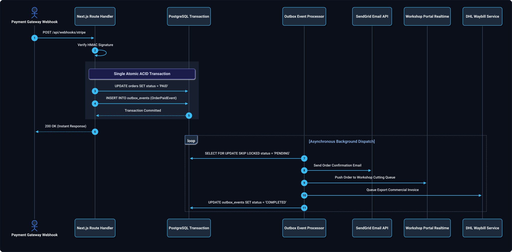

<details>
<summary>View Diagram Source (Mermaid)</summary>

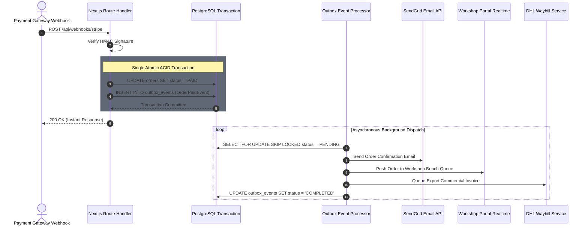

</details>

### Outbox Guarantees
1. **Atomicity:** An order cannot be marked `PAID` without staging its `OrderPaidDomainEvent` in `outbox_events`.
2. **Sub-100ms Response:** Webhooks and checkout Server Actions return immediately without waiting for third-party HTTP roundtrips.
3. **Idempotent Dispatch:** Consumers handle duplicate deliveries idempotently using the unique event UUID.
