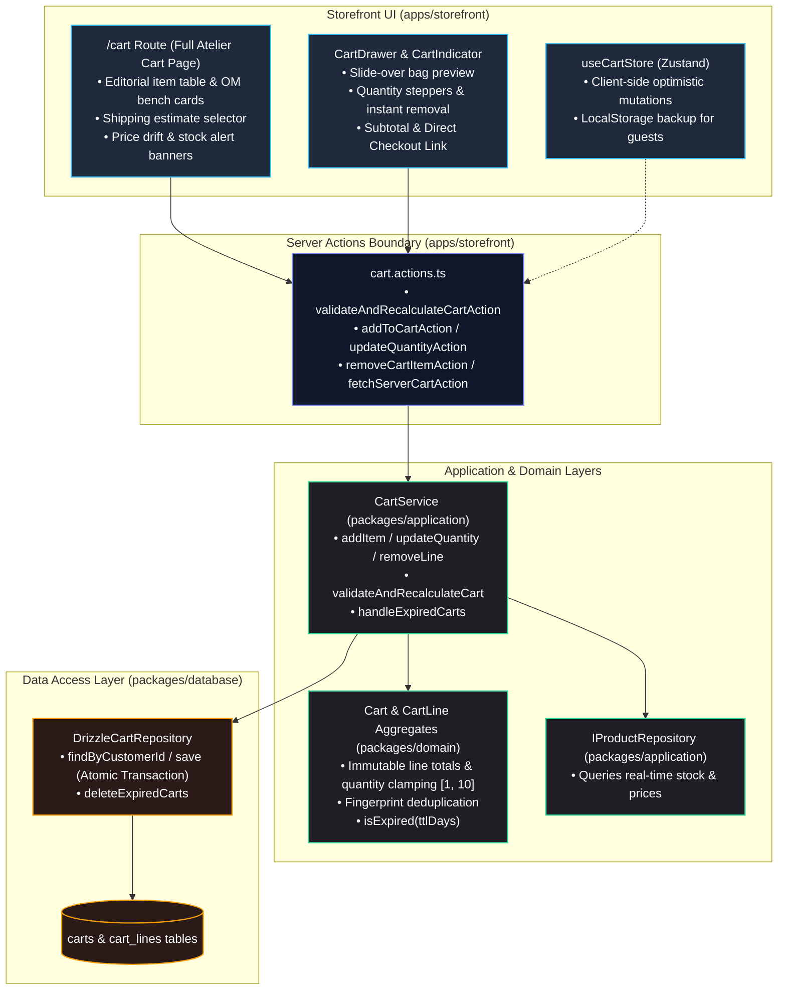

# Implementation Plan: State 12 — Cart (JN-209 through JN-222)

## Goal Description
Implement **State 12 (Cart)** of the Project 925 monorepo following Domain-Driven Design (DDD) and Clean Architecture boundaries. 
This encompasses:
1. Rich application use cases in `CartService` (`packages/application`): adding items, updating quantity, removing lines, clearing carts, and cleaning up expired carts.
2. Server-authoritative cart recalculation and multi-item stock/price validation (`validateAndRecalculateCart`): detecting price drift, verifying DROP batch inventory availability, flagging discontinued/sold-out variants, and recalculating shipping and grand totals.
3. Persistent cart access via `ICartRepository` port and `DrizzleCartRepository` implementation.
4. Presentation layer in `apps/storefront`: mini-cart drawer enhancements ([`cart-drawer.tsx`](file:///home/sarakb/projects/Jeanius/apps/storefront/components/cart-drawer.tsx)), full dedicated editorial cart page ([`/cart`](file:///home/sarakb/projects/Jeanius/apps/storefront/app/cart/page.tsx)), reusable atelier cart summary ([`cart-summary.tsx`](file:///home/sarakb/projects/Jeanius/apps/storefront/components/cart-summary.tsx)), and Server Actions in [`cart.actions.ts`](file:///home/sarakb/projects/Jeanius/apps/storefront/actions/cart.actions.ts).
5. Comprehensive unit tests covering domain invariants, application workflows, stock validation, and concurrent inventory changes (JN-222).

---

## User Review Required

> [!IMPORTANT]
> **Server-Authoritative Validation vs. Ephemeral Client State:**
> - In accordance with JN-214, JN-215, and JN-216, client totals in `useCartStore` are purely ephemeral estimates. 
> - Any checkout action or explicit cart recalculation triggers `validateAndRecalculateCartAction` which re-checks prices and inventory against the database catalog. 
> - If a DROP item's stock is lower than requested, quantity is clamped to available stock with a descriptive warning banner.
> - If an OM base price or variant price has changed, the server updates the unit price and flags `hasPriceChanges: true`.

> [!IMPORTANT]
> **Cart Expiration Strategy (JN-221):**
> - Inactive carts older than 14 days are considered expired.
> - `ICartRepository` exposes `deleteExpiredCarts(cutoffDate: Date)` to purge stale abandoned rows from `carts` and `cart_lines` without affecting customer profiles or order histories.

---

## Architecture & Data Flow



---

## Proposed Changes

### 1. Domain Layer (`packages/domain`)

#### [MODIFY] [`packages/domain/src/cart/cart.entity.ts`](file:///home/sarakb/projects/Jeanius/packages/domain/src/cart/cart.entity.ts)
- Add expiration check method: `isExpired(ttlDays: number = 14): boolean`.
- Add `findLine(lineId: CartLineId): CartLine | undefined`.
- Enhance line manipulation helpers.

---

### 2. Contracts Layer (`packages/contracts`)

#### [MODIFY] [`packages/contracts/src/index.ts`](file:///home/sarakb/projects/Jeanius/packages/contracts/src/index.ts)
- Add schemas and DTOs:
  - `CartItemWarningSchema`: `{ lineId: string, code: 'PRICE_CHANGED' | 'OUT_OF_STOCK' | 'QUANTITY_CLAMPED' | 'DISCONTINUED', message: string, previousValue?: string | number, currentValue?: string | number }`
  - `ValidatedCartDtoSchema`: Extends `CartDto` with `warnings: CartItemWarningDto[]`, `hasUnavailableItems: boolean`, `hasPriceChanges: boolean`, `estimatedShippingAmount: number`, `grandTotalAmount: number`.
  - `UpdateCartItemQuantitySchema`: `{ lineId: string, quantity: number }`.
  - `RemoveCartItemSchema`: `{ lineId: string }`.

---

### 3. Application Layer (`packages/application`)

#### [MODIFY] [`packages/application/src/cart/cart-repository.port.ts`](file:///home/sarakb/projects/Jeanius/packages/application/src/cart/cart-repository.port.ts)
- Add `deleteExpiredCarts(olderThan: Date): Promise<number>` to `ICartRepository`.

#### [MODIFY] [`packages/application/src/cart/cart.service.ts`](file:///home/sarakb/projects/Jeanius/packages/application/src/cart/cart.service.ts)
- Extend constructor to accept optional `IProductRepository` for stock and catalog verification.
- Implement methods:
  - `addItem(customerId: string, item: AddToCartInputDto): Promise<Cart>` (JN-211).
  - `updateQuantity(customerId: string, lineId: string, quantity: number): Promise<Cart>` (JN-212).
  - `removeLine(customerId: string, lineId: string): Promise<Cart>` (JN-213).
  - `validateAndRecalculateCart(items: readonly CartItemDto[], customerId?: string | null): Promise<ValidatedCartDto>` (JN-214, JN-215, JN-216, JN-217):
    - Validates each item against catalog.
    - Clamps DROP quantities when inventory is lower than requested.
    - Flags discontinued or out-of-stock items.
    - Detects price changes and adjusts unit price to server-authoritative amount.
    - Computes estimated shipping based on order total (e.g. Free Kathmandu Atelier Express shipping on orders $\ge \$300$, else $\$25$).
  - `handleExpiredCarts(cutoffDate: Date): Promise<number>` (JN-221).

#### [NEW] [`packages/application/src/cart/cart.service.test.ts`](file:///home/sarakb/projects/Jeanius/packages/application/src/cart/cart.service.test.ts)
- Add comprehensive tests for `addItem`, `updateQuantity`, `removeLine`, stock validation (JN-215), price changes (JN-216), discontinued variants (JN-217), and concurrent stock changes (JN-222).

---

### 4. Database Layer (`packages/database`)

#### [MODIFY] [`packages/database/src/repositories/cart/drizzle-cart.repository.ts`](file:///home/sarakb/projects/Jeanius/packages/database/src/repositories/cart/drizzle-cart.repository.ts)
- Implement `deleteExpiredCarts(olderThan: Date): Promise<number>` using `delete(carts).where(lt(carts.updatedAt, olderThan))` within transaction cascade.

---

### 5. Storefront Presentation Layer (`apps/storefront`)

#### [MODIFY] [`apps/storefront/actions/cart.actions.ts`](file:///home/sarakb/projects/Jeanius/apps/storefront/actions/cart.actions.ts)
- Add Server Actions:
  - `validateAndRecalculateCartAction(guestItems?: CartItemDto[])`: Returns `ActionResult<ValidatedCartDto>`.
  - `addItemToCartAction(item: AddToCartInputDto)`: Adds item server-side for authenticated collector or validates for guest.
  - `updateCartItemQuantityAction(lineId: string, quantity: number)`: Updates item quantity.
  - `removeCartItemAction(lineId: string)`: Removes item.
  - `clearCartAction()`: Clears cart.

#### [NEW] [`apps/storefront/components/cart-summary.tsx`](file:///home/sarakb/projects/Jeanius/apps/storefront/components/cart-summary.tsx)
- Reusable luxury editorial cart summary card:
  - Displays Subtotal, Kathmandu Workshop Packaging, Express Shipping, and Grand Total.
  - Shipping tier progression indicator ($X away from complimentary international dispatch).
  - High-contrast button linking to `/checkout`.

#### [MODIFY] [`apps/storefront/components/cart-drawer.tsx`](file:///home/sarakb/projects/Jeanius/apps/storefront/components/cart-drawer.tsx)
- Upgrade mini-cart with:
  - Server validation integration on open.
  - Warning badges if stock or price changed.
  - Quantity steppers and delete buttons.
  - Direct checkout CTA and view full cart link.

#### [NEW] [`apps/storefront/app/cart/page.tsx`](file:///home/sarakb/projects/Jeanius/apps/storefront/app/cart/page.tsx) & colocated [`cart-view.tsx`](file:///home/sarakb/projects/Jeanius/apps/storefront/app/cart/cart-view.tsx)
- Full `/cart` route:
  - Renders luxury atelier layout with Playfair Display headings, warm bone backgrounds (`#FDFBF7`), and slate accents.
  - Itemized table with bespoke Order-Made bench cards (showing mandrel mm, custom engraving, patina) and ready-to-ship numbered Drop allocation badges.
  - Live stock and price warning alerts with single-click dismissal or resolution.
  - Empty bag state with direct CTA back to `/shop`.
  - Full SEO metadata via `createStorefrontMetadata`.

---

## Verification Plan

### Automated Tests
1. **Domain Unit Tests:**
   ```bash
   pnpm --filter @jeanius/domain test
   ```
2. **Application Unit Tests (including concurrent stock tests JN-222):**
   ```bash
   pnpm --filter @jeanius/application test
   ```
3. **Storefront Unit & Integration Tests:**
   ```bash
   pnpm --filter @jeanius/storefront test
   ```
4. **Monorepo-Wide Verification:**
   ```bash
   ./scripts/verify-monorepo.sh
   ```

### Manual Verification
1. Visit `/cart` with an empty bag; verify empty bag aesthetic and CTA to `/shop`.
2. Configure a bespoke ring on `/shop/newar-talisman-signet-ring`, add to bag, and open mini-cart drawer (`CartDrawer`). Verify accurate bespoke specifications.
3. Navigate to `/cart`, adjust quantities, verify subtotal recalculation, and verify shipping tier threshold indicator.
4. Verify responsive mobile and desktop layouts adhere to high-contrast atelier styling.
