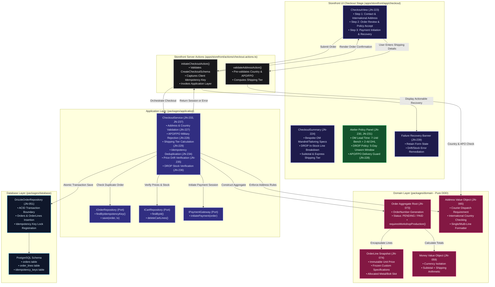

# State 13: Checkout Flow Architecture & Implementation Plan

## Executive Overview

State 13 implements the end-to-end checkout pipeline (**JN-223 through JN-239**) for Project 925 (Kathmandu Workshop). It connects the validated shopping bag from State 12 to commercial order creation, international courier validation, bespoke Order-Made (OM) lead time disclosures, ready-to-wear DROP return policies, and payment session initiation.

In strict adherence to Domain-Driven Design (DDD) and Clean Architecture principles:
- **`packages/domain`**: Enforces physical address validation invariants, country delivery rules, APO/FPO military address constraints, shipping tier calculation, and immutable Order/OrderLine state.
- **`packages/contracts`**: Defines type-safe schemas for checkout initiation, international addresses, delivery restrictions, and checkout results.
- **`packages/application`**: Houses `CheckoutService`, which coordinates address checks, inventory reservation, price drift verification, idempotency locks, atomic order persistence, and payment gateway delegation.
- **`packages/database`**: Implements transactional persistence in `DrizzleOrderRepository` within PostgreSQL ACID transactions.
- **`apps/storefront`**: Provides an editorial, luxury checkout experience (`apps/storefront/app/checkout/`) with step progression, real-time courier validation, bespoke OM atelier disclosures, and zero-loss failure recovery UX.

---

## Architecture Diagram


<details>
<summary>View Raw Diagram Source (.mmd)</summary>


</details>

---

## Task Matrix & Implementation Breakdown

### 1. JN-223: Checkout Route & Application Shell
- **Path:** `apps/storefront/app/checkout/page.tsx` & `apps/storefront/app/checkout/checkout-view.tsx`
- **Design:** Editorial ivory/bone substrate (`#FDFBF7`) with high-contrast slate typography (`#121826`), step progression indicator (1. Delivery Details, 2. Workshop Review, 3. Payment Initiation), and secure lock badge.
- **Data Loading:** Server Component fetches session profile (for logged-in customer autofill) and cart items.

### 2. JN-224: Checkout Summary with Exact Configurations
- **Path:** `apps/storefront/components/checkout-summary.tsx`
- **Features:**
  - Distinct OM bench cards: displays US Ring Mandrel size, metal alloy (925 Silver, 18k Vermeil), and custom patina finish.
  - DROP cards: displays ready-to-wear size, sku, and stock reservation.
  - Price summary breakdown: Subtotal, Shipping cost (calculated per country and $300 threshold), Total.

### 3. JN-225 & JN-226: Customer Information & International Address Form
- **Path:** `apps/storefront/components/checkout-address-form.tsx`
- **Fields:**
  - Recipient Full Name, Contact Email (with account matching), Contact Phone (mandatory for international DHL dispatch customs declaration).
  - Country Selector (ISO codes), Street Address Line 1, Line 2 (suite/apt), City, State/Province, Postal/ZIP Code.

### 4. JN-227: Supported Country Validation
- **Domain Rule:** DHL Express dispatch originates in Kathmandu, Nepal. We maintain a deliverable countries registry (US, CA, UK, EU, JP, AU, NP, SG, AE, etc.). Embargoed / sanctioned destinations or unsupported regions (e.g. OFAC embargoes) are blocked with a clear notice.

### 5. JN-228: Military-Base (APO/FPO/DPO) Address Validation
- **Domain Constraint:** DHL Express and commercial couriers departing Kathmandu require physical street addresses for civil customs clearance and cannot deliver to US military APO/FPO/DPO postal boxes.
- **Rule:** `Address` VO or helper validates whether `addressLine1`, `addressLine2`, or `city` contains `APO`, `FPO`, or `DPO` patterns. If detected, checkout validation returns: `"International express couriers departing Nepal cannot deliver to APO/FPO/DPO military addresses. Please provide a physical civilian delivery address."`

### 6. JN-229: Shipping Calculation & Courier Tiers
- **Logic:**
  - Domestic Nepal (`NP`): Free local courier delivery ($0).
  - International (`!= NP`): DHL Worldwide Express:
    - If Subtotal $\ge \$300.00$, Shipping is Free ($0).
    - If Subtotal $< \$300.00$, Shipping is a flat $\$25.00$ ($2,500$ cents).

### 7. JN-230: Atelier Order-Made Lead Time Display
- **Notice:** Clear separation of timelines:
  - **Order-Made:** 7–14 business days bench fabrication (casting, gemstone setting, liver of sulfur patina, hand buffing) + 2–4 business days DHL Worldwide Express.
  - **DROP Pieces:** Dispatched within 1–2 business days from the Kathmandu warehouse + 2–4 business days DHL Worldwide Express.
  - **Split Delivery Notice:** If order contains both OM and DROP, alert the customer that pieces will either be held to ship together or dispatched in separate parcels.

### 8. JN-231: DROP Return Policy vs. Bespoke OM Final Sale
- **Policy Disclosure:**
  - **DROP Items:** 5-day unworn return window with tamper-evident security tags and luxury wooden box intact.
  - **Order-Made Items:** Handcrafted strictly to personal finger mandrel specifications. Final sale; cancellations only permitted prior to silver casting stage.

### 9. JN-232: Order Review Stage
- **Review Step:** Customers review full delivery address, line-item configurations, total charge, and click explicit acceptance checkbox for OM manufacturing lead time and DROP return policies before proceeding.

### 10. JN-233, JN-234 & JN-237: Server-side Checkout Validation, Idempotency & Order Creation
- **Path:** `packages/application/src/order/checkout.service.ts`
- **Idempotency Key:** Client generates a unique UUID on checkout initial render.
- **Duplicate Prevention:** If an order exists with the same idempotency key, the existing order ID and status are returned without double-charging or creating a duplicate row.
- **Transaction Boundary:**
  ```typescript
  await db.transaction(async (tx) => {
    // 1. Verify stock and price drifts
    // 2. Lock idempotency key
    // 3. Insert order & order_lines
    // 4. Clear cart lines
  });
  ```

### 11. JN-235 & JN-236: Price Drift & Stock Depletion Handling
- **Price Drift:** If unit price changed in the catalog since cart addition, checkout throws a typed `CheckoutError('PRICE_DRIFT', warnings)`. Checkout view highlights price updates and requires customer confirmation.
- **Stock Depletion:** If DROP quantity exceeds stock, checkout halts with `CheckoutError('STOCK_DEPLETED', warnings)` prompting the customer to reduce quantity.

### 12. JN-238 & JN-239: Payment Initiation & Failure Recovery UX
- **Initiation:** Payment gateway adapter creates a session or provides confirmation route (`/checkout/confirmation?orderId=...`).
- **Failure Recovery:** If payment or validation fails, customer remains on checkout page with all form inputs preserved and an atelier-styled warning banner explaining the exact remediation step.

---

## Detailed Layer Implementation Plan

### Layer 1: Domain (`packages/domain`)
1. Enhance `Address` VO in `packages/domain/src/common/address.vo.ts`:
   - Add `isMilitaryAddress(): boolean` detecting APO/FPO/DPO.
   - Add `isDeliverable(): { ok: boolean; reason?: string }` validating supported ISO country codes.
2. Create `ShippingCalculation` pure helper or method in domain.

### Layer 2: Contracts (`packages/contracts`)
1. Update `packages/contracts/src/index.ts`:
   - `CreateCheckoutInputSchema`:
     - `cartId`: UUID
     - `customerEmail`: string (email)
     - `shippingAddress`: `AddressSchema`
     - `billingAddress`: optional `AddressSchema`
     - `idempotencyKey`: string
     - `confirmedPriceChanges`: optional boolean
   - `CheckoutResultSchema`:
     - `success`: boolean
     - `orderId`: string
     - `orderNumber`: string
     - `paymentUrl`: string
     - `status`: string

### Layer 3: Application (`packages/application`)
1. Extend `IOrderRepository` in `packages/application/src/order/order-repository.port.ts`:
   - `findByIdempotencyKey(key: string): Promise<Order | null>`
   - `save(order: Order, idempotencyKey?: string): Promise<void>`
2. Implement `CheckoutService` in `packages/application/src/order/checkout.service.ts`:
   - Complete orchestration including address validation, stock check, order number generation (`JN-YYYYMM-XXXX`), order aggregate creation, repository save, and cart cleanup.
3. Unit test `checkout.service.test.ts`.

### Layer 4: Database (`packages/database`)
1. Update `DrizzleOrderRepository` in `packages/database/src/repositories/order/drizzle-order.repository.ts`:
   - Support `idempotency_keys` table association or lookups.
   - Ensure atomic transactions.

### Layer 5: Storefront (`apps/storefront`)
1. Server Actions: `apps/storefront/actions/checkout.actions.ts`.
2. UI Components:
   - `apps/storefront/app/checkout/page.tsx`
   - `apps/storefront/app/checkout/checkout-view.tsx`
   - `apps/storefront/components/checkout-summary.tsx`
   - `apps/storefront/app/checkout/confirmation/page.tsx`

---

## Verification Protocol
1. Unit tests pass: `pnpm test` across `packages/domain`, `packages/application`, `packages/database`, and `apps/storefront`.
2. Code formatting: `pnpm run format`.
3. Monorepo verification: `./scripts/verify-monorepo.sh` passes with 0 errors.
4. Conventional git commit & push to `origin/feature/state-13-checkout`.
