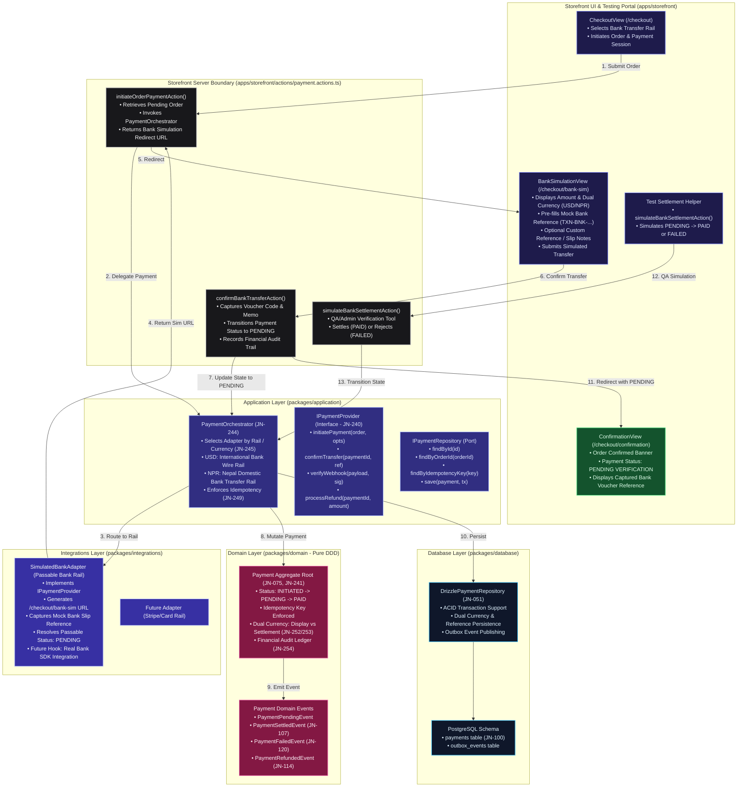

# Implementation Plan: State 14 — Payment Orchestrator & Passable Bank Rail (JN-240 → JN-258)

## Goal Description
Implement **State 14: Payment Orchestrator** ([`JN-240` → `JN-258`](file:///home/sarakb/projects/Jeanius/Production_Implementation.md#L503-L539)) using pure Domain-Driven Design and Hexagonal Architecture. 

As aligned during `/grill-me`, this implementation introduces **Bank Transfer** as the primary active payment rail configured as a **passable, executable simulated provider** for end-to-end testing and demonstration. Because official banking infrastructure and API credentials are pending selection, the orchestrator decouples the domain from any vendor specifics. The customer checkout flow safely finishes with payment status **`PENDING`** (awaiting manual/batch bank settlement), backed by dedicated testing simulation tools and a comprehensive automated test suite.

---

## Architectural Diagram


<details>
<summary>View Raw Diagram Source (.mmd)</summary>


</details>

---

## User Review Required

> [!IMPORTANT]
> **Key Design Decisions Aligned with User:**
> 1. **Bank Provider Only:** The active production/testing rail is configured for `BANK_TRANSFER`.
> 2. **Passable Simulated Gateway:** A lightweight mock bank portal (`/checkout/bank-sim`) allows testers to view transfer details, review the pre-filled reference code (`TXN-BNK-...`), add optional notes, and submit.
> 3. **Customer Flow Terminates at `PENDING`:** The order and payment status will remain `PENDING` on checkout completion, clearly communicating that the workshop awaits bank wire clearance before beginning silver casting.
> 4. **Dual Currency Rails (JN-252 / JN-253):** Supports USD (International SWIFT/wire) and NPR (Nepal domestic bank transfer), maintaining explicit separation between display and settlement currencies.
> 5. **Dedicated QA Settlement Helper:** A secured server action `simulateBankSettlementAction` and test suite verify transitions beyond `PENDING` (`PAID`, `FAILED`, `REFUNDED`) without polluting customer checkout.

---

## Proposed Changes Grouped by Package

### 1. Domain Layer (`packages/domain`)
- **[MODIFY] [`payment.entity.ts`](file:///home/sarakb/projects/Jeanius/packages/domain/src/payment/payment.entity.ts):**
  - Add `'BANK_TRANSFER'` to `PaymentProvider` union.
  - Add `markPending(transactionId: string, notes?: string)` method to transition `INITIATED` $\rightarrow$ `PENDING`.
  - Add `settlementAmount: Money` property to satisfy `JN-252` and `JN-253`.
  - Add `notes?: string` property for bank reference/memo tracking.
- **[MODIFY] [`domain-event.ts`](file:///home/sarakb/projects/Jeanius/packages/domain/src/events/domain-event.ts):**
  - Add `PaymentPendingEvent` domain event.
- **[NEW] [`payment.entity.test.ts`](file:///home/sarakb/projects/Jeanius/packages/domain/src/payment/payment.entity.test.ts):**
  - Unit tests verifying `Payment` transitions: `INITIATED` $\rightarrow$ `PENDING` $\rightarrow$ `PAID` $\rightarrow$ `REFUNDED` and invalid state transitions.

---

### 2. Contracts Layer (`packages/contracts`)
- **[NEW] `src/payment/payment.dto.ts`:**
  - `PaymentProviderSchema`: `'BANK_TRANSFER' | 'STRIPE' | 'ESEWA' | 'KHALTI' | 'FONEPAY'`.
  - `PaymentStatusSchema`: `'INITIATED' | 'PENDING' | 'PAID' | 'FAILED' | 'EXPIRED' | 'REFUNDED' | 'PARTIALLY_REFUNDED'`.
  - `InitiatePaymentDtoSchema` & `InitiatePaymentResultDtoSchema`.
  - `ConfirmBankTransferDtoSchema` (`paymentId`, `voucherReference`, `notes`).
  - `SimulateBankSettlementDtoSchema` (`paymentId`, `action: 'SETTLE' | 'FAIL' | 'REFUND'`, `reason`).
  - `PaymentWebhookPayloadDtoSchema` & `RefundPaymentDtoSchema`.
- **[MODIFY] `src/index.ts`:**
  - Export payment DTOs and Zod validation schemas.

---

### 3. Application Layer (`packages/application`)
- **[MODIFY] [`payment-gateway.port.ts`](file:///home/sarakb/projects/Jeanius/packages/application/src/payment/payment-gateway.port.ts):**
  - Define `IPaymentProvider` interface (`JN-240`):
    - `readonly providerId: PaymentProvider`
    - `initiatePayment(order: Order, options?: PaymentInitiateOptions): Promise<PaymentInitiationResult>`
    - `confirmTransfer(paymentId: string, reference: string, notes?: string): Promise<PaymentConfirmationResult>`
    - `verifyWebhook(payload: unknown, signature: string): Promise<WebhookVerificationResult>`
    - `processRefund(payment: Payment, amount: Money, reason: string): Promise<RefundResult>`
  - Define `IPaymentRepository` port methods: `findById`, `findByOrderId`, `findByIdempotencyKey`, `save`.
- **[NEW] `src/payment/payment-orchestrator.service.ts` (`JN-244`):**
  - Multi-rail provider registry with environment-based selection (`JN-245`).
  - Routes payments to `SimulatedBankAdapter` for `BANK_TRANSFER`.
  - Enforces payment idempotency (`JN-249`).
  - Dispatches domain events to Outbox (`PaymentPendingEvent`, `PaymentSettledEvent`, `PaymentFailedEvent`).
- **[NEW] `src/payment/reconcile-payment.service.ts` (`JN-250`, `JN-251`):**
  - Handles manual or programmatic settlement, rejection, and full/partial refund processing.
- **[NEW] `src/payment/payment.service.test.ts` (`JN-255` → `JN-258`):**
  - Unit tests for failed payment recovery, duplicate payment idempotency, and refund lifecycle.

---

### 4. Integrations Layer (`packages/integrations`)
- **[NEW] `src/payment/simulated-bank.adapter.ts` (`JN-246`, `JN-247`):**
  - Implements `IPaymentProvider`.
  - Handles both USD International Bank Wire and NPR Domestic Transfer instructions.
  - Pre-generates mock voucher codes (`TXN-BNK-${Date.now()}`).
  - Generates bank simulation URL (`/checkout/bank-sim?paymentId=...&orderNumber=...`).
  - Returns passable status `PENDING` upon transfer submission.
- **[MODIFY] [`packages/integrations/src/index.ts`](file:///home/sarakb/projects/Jeanius/packages/integrations/src/index.ts):**
  - Export `SimulatedBankAdapter` and register in `PaymentOrchestrator`.

---

### 5. Database Layer (`packages/database`)
- **[MODIFY] [`schema/payments.ts`](file:///home/sarakb/projects/Jeanius/packages/database/src/schema/payments.ts):**
  - Ensure columns exist for `notes`, `settlement_amount_cents`, `settlement_currency`, `voucher_reference`.
- **[NEW] `src/repositories/drizzle-payment.repository.ts` (`JN-051`):**
  - Implements `IPaymentRepository`.
  - Supports atomic transaction persistence with outbox events.

---

### 6. Storefront Presentation Layer (`apps/storefront`)
- **[NEW] `actions/payment.actions.ts`:**
  - `initiateOrderPaymentAction(orderId)`
  - `confirmBankTransferAction(input: ConfirmBankTransferDto)`
  - `simulateBankSettlementAction(input: SimulateBankSettlementDto)`
- **[NEW] `app/checkout/bank-sim/page.tsx` & colocated `bank-simulation-view.tsx`:**
  - Simulated Bank Portal UI with dark/ecru atelier luxury theme.
  - Displays order number, customer name, total due in USD or NPR.
  - Auto-fills bank voucher reference with option to customize.
  - Displays Kathmandu Atelier bank wire details (Bank Name, SWIFT, Account Number).
  - "Submit Bank Transfer to Atelier" button that transitions status to `PENDING` and redirects to `/checkout/confirmation`.
- **[MODIFY] `app/checkout/confirmation/page.tsx`:**
  - Renders bank transfer receipt banner:
    - **Status:** `PENDING VERIFICATION` (Yellow/amber badge)
    - **Bank Reference:** Display the captured voucher code.
    - **Workshop Notice:** Made-to-order bench queue activates immediately upon bank wire clearance.

---

## Verification Plan

### Automated Tests
1. **Domain Tests:**
   ```bash
   pnpm --filter @jeanius/domain test
   ```
   *Expected: All Payment entity state transitions pass (INITIATED $\rightarrow$ PENDING $\rightarrow$ PAID $\rightarrow$ REFUNDED).*
2. **Application & Orchestrator Tests:**
   ```bash
   pnpm --filter @jeanius/application test
   ```
   *Expected: PaymentOrchestrator rail routing, idempotency deduplication (JN-256), failed payments (JN-255), and refunds (JN-258) pass with 0 errors.*
3. **Monorepo Build & Typecheck:**
   ```bash
   ./scripts/verify-monorepo.sh
   ```
   *Expected: Clean build, typecheck, and lint across all 10 workspaces with 0 errors.*

### Manual Verification
1. Place an Order-Made or DROP item in the bag and complete `/checkout`.
2. Select **Bank Transfer** and confirm checkout $\rightarrow$ redirects to `/checkout/bank-sim`.
3. Verify `/checkout/bank-sim` displays the order details, dual currency amount (USD/NPR), and pre-filled voucher code.
4. Click **"Submit Bank Transfer to Atelier"** $\rightarrow$ redirects to `/checkout/confirmation`.
5. Verify order confirmation displays **Payment Status: PENDING VERIFICATION** with the captured bank reference.
6. Trigger `simulateBankSettlementAction` $\rightarrow$ verify payment transitions cleanly to `PAID` without breaking.
